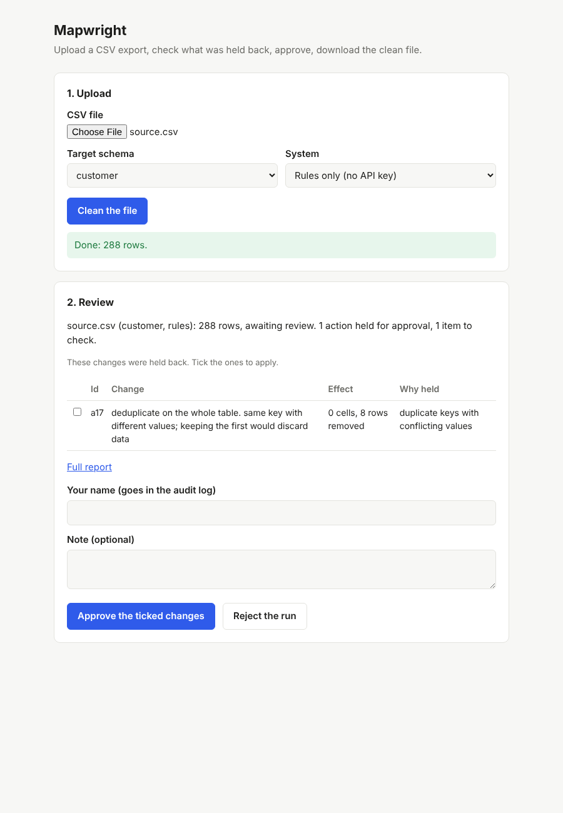

# Mapwright

Mapwright onboards messy legacy data exports into a clean, validated
target schema. Deterministic code handles structural problems; an LLM
handles the problems that need an understanding of meaning; a bounded
repair loop fixes transformations that fail validation; and anything risky
waits for human approval.

```
Analyze → Propose → Transform → Validate → Revise if needed → Human approval → Apply → Audit
```

Every claim about how well it works comes from a benchmark of 12 messy
datasets with exact ground truth, comparing rules only, the model only,
and the hybrid on the same files.

Runs entirely on your own machine. No cloud services beyond the model API.

## In one paragraph

On held-out files nobody looked at while building it (including a real
Companies House export), the hybrid fixed **0.50** of the dirty cells
against 0.37 for rules alone and 0.11 for the model alone, while leaving
**6.6** wrong-but-unflagged values per 1,000 cells against 36.5 and 34.2.
Most of what it did not fix was held for a person rather than got wrong:
with every correct held change approved, it reaches 0.996. Means of three
runs; details, ranges and the hypotheses tested are under
[Results](#results).

## What is in the repo

The contracts, benchmark, metrics and hypotheses were fixed before any
pipeline code, and the held-out cases were frozen before any system ran
on them.

| Part | Where |
| --- | --- |
| Target contracts | `contracts/` |
| Issue taxonomy (mapping, structural, semantic) | `benchmark/issue_types.yaml` |
| Benchmark: 11 generated cases and one real export, exact ground truth | `benchmark/` |
| Scorer and reference systems | `evaluation/` |
| Pipeline: ingest, profile, mapping, typed actions, validation, approval policy, audit log | `src/mapwright/` |
| Model layer: Gemini provider, response cache, mapping and value prompts, repair loop | `src/mapwright/llm/`, `src/mapwright/llmplan.py` |
| Recorded model answers, so every run replays without a key | `llm_cache/` |
| Local API and n8n review workflow | `src/mapwright/server.py`, `n8n/` |
| Design documents | `docs/` |

## The quickest way to use it

On Windows, after the setup below, double-click `start.bat`. It starts
Mapwright and opens a page in your browser: upload a CSV, pick the target
schema, tick the held changes you approve, and download the clean file.
Close the black window to stop it. On macOS or Linux, run
`python -m mapwright serve --open`.

Excel files (`.xlsx`) work too, one sheet at a time; they need
`pip install openpyxl` once. **Change the rules for this schema** on the
page shows every column of the target schema: tick whether it is required
or must be unique, and list the values it may take. Saving makes a new
schema under `contracts/custom/` (ignored by git); the built-in ones never
change.

**A free model on your own computer.** Instead of Gemini, the AI step can
use a local model through [Ollama](https://ollama.com): no API key, no
cost, and the data never leaves the machine. Install Ollama, run
`ollama pull qwen2.5:7b` once, and pick it under **AI model** on the page
(or pass `--model ollama/qwen2.5:7b` on the command line). Small local
models are weaker than Gemini, so more changes end up waiting for review.

To check a result yourself, clean one of the benchmark files on the page
(for example `benchmark/datasets/D05/source.csv`), download the result and
compare it with the known right answer:

```
python -m evaluation.check path/to/source-clean.csv D05
```

It matches rows on the key, says how many cells are identical, and lists
any differences.



## Getting started

Requires Python 3.11 or newer.

```
python -m venv .venv
.venv\Scripts\activate          # Windows
source .venv/bin/activate        # macOS / Linux
pip install -e ".[dev]"

pytest                                     # run the tests
python -m benchmark.generator verify       # check the benchmark files are intact
python -m evaluation baseline perfect runs/perfect
python -m evaluation score runs/perfect    # every metric at its best value

python -m evaluation baseline rules runs/rules --split dev   # the rules-only system
python -m evaluation score runs/rules
```

Onboarding a single file:

```
python -m mapwright run benchmark/datasets/D06/source.csv --contract contracts/sales_order.yaml --reference customer_id=benchmark/reference_customers.csv --out runs/demo
python -m mapwright replay runs/demo/plan.json benchmark/datasets/D06/source.csv --contract contracts/sales_order.yaml --out runs/demo/replayed.csv
```

Checking the Gemini key (the LLM systems need one; scoring a recorded run
does not):

```
$env:GEMINI_API_KEY = "your-key"     # PowerShell, this terminal only
python -m mapwright llm-check
```

Running the LLM systems (L, H, H−). `--record` calls Gemini for anything
not yet in `llm_cache/` and saves the answers; without it, runs replay the
cache and need no key:

```
python -m evaluation baseline llm runs/llm --model gemini-3.1-flash-lite --record
python -m evaluation baseline hybrid runs/hybrid --model gemini-3.1-flash-lite --record
python -m evaluation baseline hybrid-norepair runs/hybrid-norepair --model gemini-3.1-flash-lite
python -m evaluation score runs/hybrid
```

With a Gemini key set, the same command can use the model for what the
rules leave (`--system hybrid`) or for everything (`--system llm`):

```
python -m mapwright run examples/messy_customers.csv --contract contracts/customer.yaml --out runs/example-hybrid --system hybrid --model gemini-3.1-flash-lite
```

The run writes `target.csv`, `result.json`, `plan.json`, `report.md` and `audit.jsonl`.
`report.md` lists what was fixed, what was applied but needs sign-off, and
what is held for approval.

## Running it from n8n

`python -m mapwright serve` also starts a small local API. The n8n workflow in
`n8n/mapwright-review.json` puts a form in front of it: upload a CSV, see
what was held back, approve or reject, and the decision is written to the
run's audit log with the reviewer's name. Setup and the API reference are
in [docs/N8N.md](docs/N8N.md).

## Results

Four systems on the same files, scored against exact ground truth:
**R** rules only, **L** the model only, **H** rules first and the model for
what they leave, **H−** the hybrid without the repair loop. Model:
`gemini-3.1-flash-lite`, temperature 0, **three runs per case**. The
held-out cases (H01–H04, H04 a real Companies House export) were not
looked at while building the rules or the prompts.

Numbers are the mean of the three runs, with the lowest and highest run in
brackets. R is deterministic, so it has one value.

### Held-out

| Metric | R | L | H | H− |
| --- | --- | --- | --- | --- |
| Dirty-cell accuracy | 0.369 | 0.108 (0.103–0.111) | **0.496** (0.493–0.503) | 0.496 |
| Clean-cell preservation | 0.433 | 0.978 | **0.996** (0.989–1.000) | 0.996 |
| Silent errors per 1,000 cells | 36.5 | 34.2 (25.8–50.8) | **6.6** (2.2–15.3) | 6.6 |
| Mapping F1 | 0.66 | 0.92 (0.91–0.92) | **0.99** (0.99–1.00) | 0.99 |
| Detection F1 | 0.50 | 0.68 (0.65–0.70) | **0.90** (0.88–0.91) | 0.90 |
| Missed reviews | 9 | 11 | **2** | 2 |
| Contract pass rate | 0.57 | 0.65 | **0.81** | 0.81 |
| Model calls per case | 0 | 2.0 | 2.7 | 2.0 |

On the development cases R and H both reach 0.998 dirty-cell accuracy
with zero silent errors in every run, and H makes no model calls: the
rules already cover everything, so the model is only asked about what
they leave. L alone reaches 0.244 there, with 9.8 silent errors per 1,000
cells.

A silent error is a wrong value that passes every contract check and is
not flagged for review. It is the number that matters most in a migration,
because nobody looks at those cells again.

### Why three runs matter

Accuracy barely moves between runs; silent errors do. In the first run H
had 15.3 silent errors per 1,000 cells, in the other two 2.2. The whole
difference is one decision on one file: in H02 the model mapped the
`LIMIT_AMT` column to `credit_limit` with confidence 0.7 in the first run
and higher in the others. Below the 0.8 threshold the mapping is held for
approval, the column stays empty, and 158 credit limits are missing. The
model was right each time; the confidence it reported was not stable. A
single run would have reported either 2.2 or 15.3 as "the" result.

### Hypotheses

Stated in [docs/EVALUATION.md](docs/EVALUATION.md) before any results.
Verdicts use all three runs.

| # | Hypothesis | Verdict |
| --- | --- | --- |
| 1 | R matches or beats L on structural issues | **Partly.** True on dev (structural detection F1 1.00 vs 0.50–0.58). Not on held-out: R 0.35, L 0.33–0.53, higher than R in two of three runs |
| 2 | L beats R on semantic issues and non-English headers, more so on held-out | **Partly.** Semantic F1 on held-out 0.79–0.82 vs 0.58, no gap on dev (0.99 vs 1.00). Transliterated headers were mapped correctly but labelled as plain synonyms (M1), so M2 detection is 0 for both |
| 3 | H is at least as accurate as R and L | **Supported** in every run. Held-out dirty-cell accuracy 0.49–0.50 vs 0.37 and 0.10–0.11; equal to R on dev |
| 4 | H has fewer silent errors than L | **Supported** in every run. Held-out 2.2–15.3 vs 25.8–50.8 per 1,000 cells; 0 vs 9.6–10.0 on dev |
| 5 | The repair loop reduces failures without adding silent errors | **Inconclusive.** H and H− score the same in all three runs: almost no model action failed its checks, so the loop rarely ran |

### What limits the hybrid

Most of the gap between 0.50 and a perfect score is not the model getting
things wrong. It is the approval policy holding correct fixes for a
person. Any model action that changes more than 20% of a column waits for
approval. With that one rule removed
(`evaluation/policies/no-share-limit.yaml`):

| Held-out | H− | H− without the 20% rule |
| --- | --- | --- |
| Dirty-cell accuracy | 0.496 (0.493–0.503) | 0.950 (0.912–0.977) |
| Silent errors per 1,000 cells | 6.6 (2.2–15.3) | 6.8 (2.2–15.3) |
| Escalation precision | 0.56 | 0.81 |

Accuracy nearly doubles and silent errors barely move, so the held fixes
were almost all right. If a reviewer approves every correct held action,
H reaches 0.996 in every run. The rule stays on by default: approving a
batch of model changes is a person's decision, and the cost is review
time, not wrong data. Without the rule L reaches only 0.662 (0.596–0.714),
which is why the rules go first.

### Reproducing

Every model answer is in `llm_cache/`, so all runs replay without an API
key:

```
python -m evaluation baseline hybrid runs/hybrid-s1 --model gemini-3.1-flash-lite --sample 1
python -m evaluation score runs/hybrid-s1
python -m evaluation baseline hybrid-norepair runs/h-noshare-s1 --model gemini-3.1-flash-lite --sample 1 --policy evaluation/policies/no-share-limit.yaml
```

The same for `rules`, `llm` and `hybrid-norepair`, and for `--sample 0`
and `--sample 2`. The held-out rules numbers come from version 1.1 of
system R, which fixed one ingest bug found while building H04 (header
text was trimmed, so `" CompanyNumber"` no longer matched its own
column); the fix changed no score on H01–H03.

### Limits

One model, three runs per case, 12 cases. The numbers show direction, not
precise effect sizes. A second model is the next thing to add.

## Documents

- [Architecture](docs/ARCHITECTURE.md): pipeline, what is code and what is LLM, actions, validation, approval policy
- [Benchmark](docs/BENCHMARK.md): target schema, the 12 cases, ground truth format, held-out rules
- [Evaluation](docs/EVALUATION.md): systems compared, hypotheses, metrics, protocol
- [n8n](docs/N8N.md): local API and the review workflow
